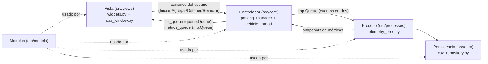

# AGENTS.md — Reglas de Arquitectura y Desarrollo del Proyecto

## 1. Información General y Contexto Académico
- **Proyecto**: Simulador de Parqueadero Inteligente con Hilos, Multiprocessing y GUI en Python
- **Institución**: Universidad EAN – Facultad de Ingeniería
- **Asignatura**: Arquitectura de Computadores y Sistemas Operativos
- **Docente**: Diana Carolina Beltrán Peña
- **Lenguaje y Entorno**: 100% Python 3.10+ (Librería Estándar + Tkinter)

---

## 2. Objetivo Principal del Proyecto
Desarrollar un simulador interactivo de parqueadero inteligente en **Python** con interfaz gráfica en **Tkinter** que represente de forma visual y cuantitativa cómo un **Sistema Operativo (SO)** gestiona múltiples procesos/hilos (vehículos) que compiten de manera concurrente por un conjunto finito de recursos compartidos (espacios o cupos de parqueo), aplicando **hilos (`threading`)**, **semáforos (`Semaphore`)**, **exclusión mutua (`Lock`)** y **procesamiento paralelo (`multiprocessing`)**.

### Analogía con un Sistema Operativo (SO)
| Concepto de Sistemas Operativos | Representación en el Simulador de Parqueadero |
| :--- | :--- |
| **Sistema Operativo (Gestor de Recursos)** | Sistema central de control del parqueadero inteligente |
| **Recurso Finito (CPU / Memoria RAM / E/S)** | Cupos o espacios físicos del parqueadero (`CAPACIDAD = N`) |
| **Hilo de Ejecución (`threading.Thread`)** | Cada **Vehículo** independiente que solicita ingresar, estacionarse y salir |
| **Semáforo Contador (`threading.Semaphore(N)`)** | Controlador de cupos disponibles en el parqueadero |
| **Mutex / Cerrojo Binario (`threading.Lock()`)** | Protección de **sección crítica** al modificar `ocupados` y el mapa de cajones |
| **Planificación y Bloqueo de Procesos** | Cola de espera cuando el parqueadero está lleno (`acquire(timeout)`) |
| **Proceso Independiente (`multiprocessing.Process`)** | Subsistema de **Telemetría, Analítica SO y Persistencia CSV** en segundo plano |
| **Estados de un Proceso en el SO** | `Nuevo (Llegando)` $\rightarrow$ `Listo/Bloqueado (Esperando cupo)` $\rightarrow$ `En Ejecución (Estacionado)` $\rightarrow$ `Terminado (Salió)` |

---

## 3. Reglas Inquebrantables de Arquitectura (Obligatorias para Agentes y Desarrolladores)

> [!IMPORTANT]
> Cualquier modificación o adición de código en este repositorio **DEBE** cumplir estrictamente las siguientes reglas técnicas. No se permiten atajos que violen el modelo de concurrencia o las buenas prácticas de Tkinter.

### Regla 1: Cada Vehículo es un Hilo (`threading.Thread`)
- Cada vehículo que ingresa a la simulación debe instanciarse como un hilo independiente (`threading.Thread`).
- **Ciclo de vida obligatorio del vehículo**:
  1. **Llegada (`Nuevo`)**: Espera un tiempo aleatorio inicial antes de intentar ingresar al parqueadero.
  2. **Solicitud de Recurso (`Listo / Esperando`)**: Intenta adquirir un cupo a través del semáforo (`semaforo.acquire(timeout=...)`). Si el parqueadero está lleno, el hilo permanece en espera notificando su estado de bloqueo.
  3. **Ingreso en Sección Crítica**: Una vez adquirido el semáforo, adquiere el `threading.Lock()` para incrementar la variable compartida `ocupados += 1` y reclamar un cajón libre específico sin condiciones de carrera (*race conditions*).
  4. **Estadia (`En Ejecución / Estacionado`)**: Permanece estacionado durante un tiempo aleatorio simulado (dividido en intervalos pequeños o controlado con `Event.wait()` para permitir detención inmediata).
  5. **Salida en Sección Crítica (`Terminado`)**: Adquiere nuevamente el `threading.Lock()` para decrementar `ocupados -= 1` y liberar su cajón físico, y finalmente ejecuta `semaforo.release()` antes de finalizar el hilo.

### Regla 2: El Semáforo Controla la Capacidad Limitada (`threading.Semaphore`)
- La capacidad máxima del parqueadero (`CAPACIDAD`) debe estar gobernada exclusivamente por `threading.Semaphore(CAPACIDAD)` (o `BoundedSemaphore(CAPACIDAD)` para prevenir liberaciones accidentales por encima del límite).
- **Prohibido** controlar el límite de cupos únicamente con condicionales `if ocupados < CAPACIDAD:` fuera de un semáforo, ya que el objetivo académico exige demostrar el bloqueo y planificación mediante primitivos de sincronización de SO.

### Regla 3: Exclusión Mutua Estricta con `threading.Lock`
- Toda modificación o lectura crítica de estructuras compartidas entre los hilos de vehículos (contador `ocupados`, diccionario/lista de cajones `espacios`, contadores globales) debe ejecutarse dentro de un bloque contextual `with lock:`.
- La sección crítica debe mantenerse lo más corta y rápida posible (nunca hacer `time.sleep()` dentro de `with lock:`).

### Regla 4: Rol Óptimo del Proceso Secundario (`multiprocessing.Process`)
- El proyecto debe emplear `multiprocessing.Process` para ejecutar el **Motor de Telemetría, Auditoría de Métricas SO y Persistencia CSV (`TelemetryWorkerProcess`)** en un proceso separado del sistema operativo:
  - **Justificación arquitectónica**: Mientras el proceso principal ejecuta el bucle de eventos de `Tkinter` y coordina los hilos de los vehículos que comparten memoria (`Semaphore` y `Lock`), el proceso secundario corre en paralelo real (otro proceso del SO con su propio GIL) recibiendo eventos vía `multiprocessing.Queue`.
  - **Responsabilidades del Proceso Secundario**:
    1. Recibir eventos crudos de los vehículos (timestamps de creación, inicio de espera, ingreso a cupo, salida).
    2. Calcular en tiempo real métricas de planificación del SO:
       - **Tiempo promedio de espera en cola (*Average Waiting Time*)**.
       - **Tiempo promedio de estancia/servicio (*Service Time*)** y **Tiempo de retorno (*Turnaround Time*)**.
       - **Porcentaje de utilización del recurso (*Resource Utilization %*)**.
       - **Productividad (*Throughput*: vehículos atendidos por minuto)**.
    3. Persistir de forma asíncrona y segura todos los eventos en archivos de registro (`.csv` / `.log`) para el análisis final del informe, **delegando la escritura a la capa aislada `src/data/` (`csv_repository.py`)**.
    4. Enviar snapshots estadísticos de regreso al proceso principal mediante una cola de resultados (`multiprocessing.Queue`).

### Regla 5: Seguridad de Hilos en la GUI (`Tkinter` + `queue.Queue` + `.after()`)
- **PROHIBIDO** invocar métodos de widgets de `Tkinter` (`label.config()`, `canvas.itemconfig()`, `tree.insert()`, etc.) desde un hilo secundario (`threading.Thread`) o desde otro proceso. `Tkinter` no es *thread-safe*.
- **Patrón obligatorio**:
  - Los hilos de vehículos depositan mensajes de actualización visual en una cola segura `ui_queue = queue.Queue()`.
  - El hilo principal de `Tkinter` ejecuta un método periódico cada `100 ms` usando `root.after(100, procesar_eventos_ui)` que vacía `ui_queue` y `metrics_queue` (`get_nowait()`) y actualiza las etiquetas, barras de progreso, grilla de espacios y tabla de vehículos.

### Regla 6: Prohibición de Bucles Bloqueantes y Manejo Limpio de Parada
- **Prohibido** usar `while True:` sin pausas ni condiciones de salida.
- Todo bucle de espera debe verificar un `stop_event = threading.Event()` y emplear `semaforo.acquire(timeout=0.5)` para que los botones **Detener**, **Reiniciar** y el cierre de la ventana (`WM_DELETE_WINDOW`) finalicen todos los hilos y el proceso de `multiprocessing` de forma limpia, sin dejar procesos zombies ni bloquear la interfaz.

### Regla 7: Separación Estricta de Capas (MVC)
- Respetar la matriz de dependencias de la sección 6.1. Está **prohibido** importar `tkinter` fuera de `src/views/` y `main.py`.
- Está **prohibido** abrir, escribir o leer archivos fuera de `src/data/`.
- La Vista no contiene lógica de negocio; el Controlador no conoce widgets; los Modelos no tienen efectos secundarios.
- Todo mensaje que cruce capas o procesos debe ser un `dataclass` definido en `src/models/` (y *picklable* si cruza procesos).
- Todo archivo nuevo debe ubicarse en la capa que corresponda; si no encaja, se debe discutir antes de crear una carpeta nueva.

### Regla 8: Calidad de Código y Documentación
- Código y comentarios técnicos con propósito claro: cada hilo/proceso debe documentar su rol (requisito de la rúbrica).
- Usar *type hints* y docstrings en clases y funciones públicas.
- Nombres de módulos, clases y funciones consistentes con la estructura de la sección 6.
- Toda funcionalidad nueva del núcleo de concurrencia debe incluir su prueba en `tests/`.

### Regla 9: Flujo de Trabajo y Convención de Commits
- Ver la sección 9. **Todos los commits deben redactarse SIEMPRE en inglés** y seguir *Conventional Commits*.

---

## 4. Herramientas Utilizadas y Stack Tecnológico
Todo el proyecto se desarrolla **exclusivamente en Python** utilizando su librería estándar para garantizar máxima compatibilidad académica y cero fricción de instalación:

- **`tkinter` y `tkinter.ttk`**: Construcción de la interfaz gráfica moderna (grilla visual de parqueadero, tabla de estados de vehículos/procesos, paneles de métricas de SO, bitácora en vivo y controles).
- **`threading`**: Creación de hilos por vehículo (`Thread`), control de capacidad (`Semaphore` / `BoundedSemaphore`), exclusión mutua (`Lock`) y señalización de parada (`Event`).
- **`multiprocessing`**: Proceso dedicado al cálculo estadístico y persistencia (`Process`, `Queue`, `Event`).
- **`queue`**: Comunicación *thread-safe* (`queue.Queue`, `queue.Empty`) entre los hilos de vehículos y el hilo principal de Tkinter.
- **`random` y `time`**: Generación de tiempos aleatorios de llegada y estacionamiento, con soporte para `random.seed()` que permite **reproducibilidad exacta** de experimentos.
- **`csv`, `os`, `datetime`, `dataclasses`**: Estructuración tipada de eventos y exportación automática de reportes en formato CSV para el análisis de desempeño.

---

## 5. Requerimientos Funcionales de la Interfaz Gráfica (GUI)
La ventana principal de `Tkinter` debe incluir obligatoriamente:
1. **Panel Visual de Espacios (Cupos del Parqueadero)**:
   - Indicadores claros de **Espacios Disponibles vs. Ocupados** (contador numérico, barra de ocupación y representación gráfica de cada cajón $1 \dots N$ mostrando qué vehículo lo ocupa).
2. **Lista / Tabla de Vehículos en Tiempo Real**:
   - Identificador del vehículo (`Vehículo #ID` / Placa), **Estado Actual** (`Llegando`, `Esperando cupo (Bloqueado)`, `Estacionado (Sección Crítica)`, `Salió (Terminado)`), cajón asignado, tiempo de espera acumulado y tiempo de estacionamiento.
3. **Botones de Control Obligatorios**:
   - `Iniciar simulación`: Arranca la generación inicial de vehículos y el motor de telemetría.
   - `Agregar vehículo`: Permite inyectar dinámicamente un nuevo hilo vehículo en cualquier momento para probar picos de concurrencia.
   - `Detener`: Señaliza a los hilos activos y al proceso secundario que detengan la simulación de forma segura.
   - `Reiniciar`: Limpia contadores, reinicia el semáforo, vacía las colas, restablece la UI y prepara una nueva corrida (respetando la semilla `random.seed` si está configurada).
4. **Panel de Configuración y Telemetría del SO**:
   - Parámetros ajustables: `CAPACIDAD` del parqueadero, número inicial de vehículos, rangos de tiempo aleatorio y semilla (`random.seed`).
   - Indicadores en tiempo real calculados por el proceso `multiprocessing`: Tiempo promedio de espera, % de utilización del parqueadero, vehículos atendidos y vehículos en cola (bloqueados).
5. **Consola de Eventos (Log Visual)**:
   - Historial en vivo de las transiciones de sección crítica y sincronización (`[HH:MM:SS] Vehículo 4 adquirió Semáforo -> Lock -> Ocupados: 3/5`).

---

## 6. Arquitectura Modular (Patrón MVC) y Estructura del Proyecto

El proyecto adopta una **arquitectura modular basada en el patrón MVC (Modelo – Vista – Controlador)**, con una capa de **persistencia aislada** (`data/`) y una capa de **procesos** (`processes/`) para el paralelismo real.

### 6.1 Responsabilidad de cada capa

| Capa | Carpeta | Rol | Puede depender de | NO puede depender de |
| :--- | :--- | :--- | :--- | :--- |
| **Modelo (M)** | `src/models/` | Datos puros: `dataclasses`, `Enum` de estados del vehículo/proceso, eventos de UI y telemetría. **Sin lógica de concurrencia, sin Tkinter, sin I/O.** | `config` | `core`, `views`, `data`, `processes` |
| **Vista (V)** | `src/views/` | Todo lo visual en Tkinter. Contiene **un archivo de widgets** reutilizables y **un archivo orquestador** que ensambla la ventana. **Sin lógica de negocio ni primitivos de sincronización.** | `models`, `config` | `data`, `processes`, `threading.Semaphore/Lock` |
| **Controlador (C)** | `src/core/` | Lógica de la aplicación: `Semaphore`, `Lock`, ciclo de vida de los hilos de vehículos, puente entre Vista y Procesos. | `models`, `config`, `processes` | `views` (la Vista llama al controlador, nunca al revés) |
| **Procesos** | `src/processes/` | `multiprocessing.Process` de telemetría y métricas SO. Recibe eventos por `multiprocessing.Queue`. | `models`, `data`, `config` | `views`, `core` |
| **Persistencia** | `src/data/` | Acceso aislado a disco (repositorio CSV/log). Única capa que abre archivos. | `models`, `config` | `views`, `core` |

> [!NOTE]
> **Nombre de la carpeta de persistencia**: se usa `data/` (patrón *Repository / Data Access Layer*). Se evita `server/` porque el proyecto no tiene arquitectura cliente-servidor y el nombre induciría a error.

### 6.2 Flujo de dependencias y comunicación



- La **Vista** nunca modifica el estado compartido directamente: invoca métodos públicos del controlador y lee de las colas en `.after(100, ...)`.
- El **Controlador** es el único dueño de `Semaphore`, `Lock`, `ocupados` y del mapa de cajones.
- Los **Modelos** son el contrato de datos entre capas e inter-proceso (deben ser *picklables*).

### 6.3 Estructura de directorios

```text
smart-parking-threads/
├── AGENTS.md                      # Este documento maestro de reglas y arquitectura
├── README.md                      # Documentación general e instrucciones de ejecución
├── main.py                        # Punto de entrada: compone Modelo + Controlador + Vista
├── src/
│   ├── __init__.py
│   ├── config.py                  # Parámetros globales (CAPACIDAD, tiempos, random.seed, colores)
│   ├── models/                    # [M] Modelos
│   │   ├── __init__.py
│   │   ├── events.py              # Dataclasses de eventos de UI y telemetría inter-proceso
│   │   ├── vehicle.py             # Dataclass/Enum del vehículo y sus estados (Nuevo, Esperando, Estacionado, Salió)
│   │   └── metrics.py             # Dataclass de snapshot de métricas SO
│   ├── views/                     # [V] Vistas (Tkinter)
│   │   ├── __init__.py
│   │   ├── widgets.py             # Widgets reutilizables: grilla de cajones, tabla de vehículos, panel de métricas, consola de eventos, panel de configuración y controles
│   │   └── app_window.py          # Orquestador: ensambla widgets, enlaza botones al controlador y ejecuta el ciclo .after(100)
│   ├── core/                      # [C] Controlador (lógica de la aplicación)
│   │   ├── __init__.py
│   │   ├── parking_manager.py     # Semaphore(CAPACIDAD), Lock(), cupos, cajones, creación/parada de hilos
│   │   └── vehicle_thread.py      # Clase Vehiculo(threading.Thread) con ciclo de vida completo
│   ├── processes/                 # Paralelismo real (multiprocessing)
│   │   ├── __init__.py
│   │   └── telemetry_proc.py      # Process: cálculo de métricas SO; delega la escritura a src/data
│   └── data/                      # Persistencia aislada (Repository)
│       ├── __init__.py
│       └── csv_repository.py      # Escritura/lectura de eventos CSV/log en logs/
├── logs/                          # Generada automáticamente con los CSV de eventos (ignorada por git)
└── tests/                         # Pruebas de concurrencia, semáforos, telemetría y persistencia
    ├── test_parking_manager.py
    ├── test_telemetry.py
    └── test_csv_repository.py
```

> [!IMPORTANT]
> Si `widgets.py` crece demasiado, puede convertirse en el paquete `src/views/widgets/` (un archivo por widget), pero `app_window.py` debe seguir siendo el **único orquestador** de la ventana.

---

## 7. Uso y Comandos de Ejecución

### Requisitos Previos
- Python `3.10` o superior instalado con soporte para `tkinter` (en Linux Ubuntu/Debian: `sudo apt-get install python3-tk`).

### Ejecutar el Simulador
Desde la raíz del proyecto:
```bash
python3 main.py
```

### Ejecutar Pruebas de Verificación (Concurrencia y Multiprocessing)
```bash
python3 -m unittest discover -s tests
```

---

## 8. Referencia Rápida: Pseudocódigo Base de Sincronización
Todo agente que implemente o modifique el núcleo de concurrencia debe respetar la lógica del anexo técnico oficial:

```python
# Configuración inicial en Proceso Principal
CAPACIDAD = N
semaforo = threading.BoundedSemaphore(CAPACIDAD)
lock = threading.Lock()
ocupados = 0

# Hilo de cada vehículo (threading.Thread)
def ciclo_vehiculo(id_vehiculo):
    esperar_tiempo_aleatorio_llegada()
    notificar_ui_y_telemetria(id_vehiculo, estado="ESPERANDO_CUPO")

    while not stop_event.is_set():
        # Intenta adquirir cupo en el semáforo con timeout para no bloquear indefinidamente
        if semaforo.acquire(timeout=0.5):
            try:
                with lock:  # Inicio Sección Crítica (Entrada)
                    ocupados += 1
                    cajon = asignar_cajon_libre(id_vehiculo)
                # Fin Sección Crítica (Entrada)

                notificar_ui_y_telemetria(id_vehiculo, estado="ESTACIONADO", cajon=cajon)
                estacionar_tiempo_aleatorio(stop_event)

                with lock:  # Inicio Sección Crítica (Salida)
                    ocupados -= 1
                    liberar_cajon(cajon)
                # Fin Sección Crítica (Salida)

                notificar_ui_y_telemetria(id_vehiculo, estado="SALIO", cajon=cajon)
            finally:
                semaforo.release()  # Siempre libera el recurso compartido
            break
        else:
            notificar_ui_y_telemetria(id_vehiculo, estado="BLOQUEADO_EN_COLA")
```

---

## 9. Flujo de Trabajo y Estándar de Commits

> [!IMPORTANT]
> **OBLIGATORIO: TODOS LOS COMMITS SE REDACTAN SIEMPRE EN INGLÉS** (tipo, alcance, descripción y cuerpo). Aplica a desarrolladores y agentes, sin excepción.

Se sigue la especificación **[Conventional Commits](https://www.conventionalcommits.org/)**.

### 9.1 Formato

```text
<type>(<scope>): <short description in English>

[optional body: what and why, not how]

[optional footer: BREAKING CHANGE: ... / Closes #issue]
```

- Descripción en **modo imperativo**, minúscula inicial, **sin punto final**, máximo ~72 caracteres.
- `scope` opcional, referido a la capa/módulo: `models`, `views`, `core`, `processes`, `data`, `config`, `tests`, `docs`, `deps`.
- Un commit = un cambio lógico. No mezclar refactor con nuevas funcionalidades.
- Cambios incompatibles: añadir `!` tras el tipo/alcance (`feat(core)!:`) y un footer `BREAKING CHANGE:`.

### 9.2 Labels (tipos) permitidos

| Label | Uso |
| :--- | :--- |
| `feat` | Nueva funcionalidad |
| `add` | Añadir archivos, recursos o dependencias nuevas sin lógica funcional |
| `fix` | Corrección de un error |
| `hotfix` | Corrección urgente y crítica |
| `docs` | Cambios solo de documentación (README, AGENTS.md, docstrings) |
| `style` | Formato (espacios, comas, indentación) sin cambio de lógica |
| `refactor` | Reestructuración de código sin cambiar comportamiento |
| `perf` | Mejora de rendimiento |
| `test` | Añadir o corregir pruebas |
| `build` | Sistema de build o dependencias |
| `ci` | Configuración de integración continua |
| `chore` | Tareas de mantenimiento (ej. `.gitignore`) |
| `revert` | Revertir un commit anterior |
| `remove` | Eliminar código, archivos o dependencias |
| `rename` | Renombrar o mover archivos/carpetas |
| `init` | Commit inicial o inicialización de módulos |
| `wip` | Trabajo en progreso (solo en ramas personales, nunca en `main`) |
| `merge` | Merge manual de ramas (cuando no lo genera git) |
| `release` | Preparación de una versión/entrega |

### 9.3 Ejemplos

```text
init: bootstrap project structure following MVC layout
feat(core): add bounded semaphore to control parking capacity
feat(views): add parking grid widget showing slot occupancy
add(data): add csv repository for vehicle events
fix(core): release semaphore in finally block on thread stop
refactor(processes): extract metrics calculation into helper functions
test(core): add race condition test for shared occupied counter
docs: document MVC architecture and commit conventions in AGENTS.md
remove(views): delete unused legacy status label
rename(gui): move gui package to views
chore: add logs directory to .gitignore
```

### 9.4 Reglas de ramas y proceso
- Ramas de trabajo: `feat/<tema>`, `fix/<tema>`, `docs/<tema>`, `refactor/<tema>` (nombres en inglés y en `kebab-case`).
- No hacer commits directos de código roto en `main`; las pruebas (`python3 -m unittest discover -s tests`) deben pasar antes de integrar.
- Nunca versionar `logs/`, `__pycache__/` ni archivos `.csv` generados.
