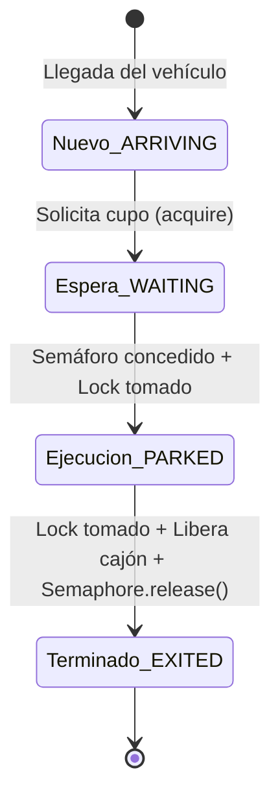
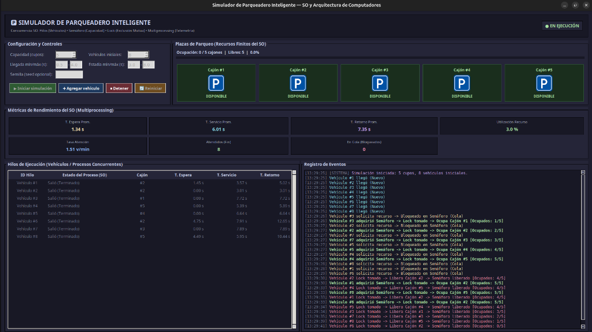

# PROYECTO FINAL — SIMULADOR DE PARQUEADERO INTELIGENTE CON HILOS, MULTIPROCESSING Y GUI EN PYTHON

**Universidad EAN — Facultad de Ingeniería**  
**Curso**: Arquitectura de Computadores y Sistemas Operativos  
**Docente**: Diana Carolina Beltrán Peña  
**Estudiantes**: [Nombres y Apellidos de los Integrantes]  
**Fecha / Semestre**: Semestre 2026-2 — Bogotá D.C.  

---

## 1. Descripción del Sistema y Analogía con Sistemas Operativos

El proyecto implementa un simulador interactivo de parqueadero inteligente en **Python** con interfaz gráfica en **Tkinter**. Su propósito académico es modelar y visualizar de forma cuantitativa cómo un **Sistema Operativo (SO)** administra la concurrencia, sincronización y competencia de múltiples procesos por un conjunto finito y compartido de recursos del sistema.

### Analogía Conceptual con un Sistema Operativo

| Concepto de Sistemas Operativos | Implementación en el Simulador de Parqueadero |
| :--- | :--- |
| **Sistema Operativo (Gestor de Recursos)** | Módulo central de control del parqueadero ([`ParkingManager`](../src/core/parking_manager.py)) |
| **Recursos Finitos Compartidos (CPU / Memoria RAM)** | Cajones físicos del parqueadero gobernados por una capacidad límite ($N=5$) |
| **Proceso / Hilo de Ejecución (`Thread`)** | Cada **Vehículo** independiente que solicita acceso, se estaciona y sale |
| **Semáforo Contador (`Semaphore`)** | Controlador del cupo total disponible; bloquea solicitudes cuando el cupo llega a cero |
| **Mutex / Cerrojo Binario (`Lock`)** | Protección de la **sección crítica** para modificar atómicamente el mapa de cajones y contadores |
| **Planificación y Cola de Bloqueo** | Hilos suspendidos en espera (`acquire(timeout)`) hasta que otro vehículo libera un cupo |
| **Proceso Independiente Multiprocesamiento** | Proceso secundario paralelo ([`TelemetryWorker`](../src/processes/telemetry_proc.py)) para analítica SO y persistencia CSV |

### Mapeo de Estados del Ciclo de Vida del Proceso

Cada vehículo transita por los estados fundamentales de un proceso en el SO:
1. **Nuevo (`ARRIVING`)**: El hilo nace e introduce una latencia aleatoria de llegada para simular solicitudes asíncronas.
2. **Listo / Bloqueado (`WAITING`)**: El vehículo invoca `semaphore.acquire()`. Si hay cupos libres, transita de inmediato; si el parqueadero está saturado, el SO suspende el hilo en la cola de espera.
3. **En Ejecución (`PARKED`)**: El hilo adquirió el recurso, entra a la sección crítica (`with lock:`) para reclamar su cajón físico y permanece en servicio durante su tiempo aleatorio de estadía.
4. **Terminado (`EXITED`)**: Entra nuevamente a sección crítica (`with lock:`) para desalojar el cajón y ejecuta `semaphore.release()`, notificando al planificador la liberación del recurso.

---

## 2. Arquitectura de Concurrencia, Exclusión Mutua y Sincronización

La solución adopta una **Arquitectura en Capas basada en MVC**, desacoplando la interfaz gráfica del motor de sincronización y de la analítica en segundo plano:

1. **Hilos Independientes por Vehículo ([`VehicleThread`](../src/core/vehicle_thread.py))**:
   Cada vehículo ejecuta su propio hilo (`threading.Thread`). Para garantizar una detención limpia y sin bloqueos residuales, los tiempos de estadía y espera utilizan eventos de parada (`threading.Event.wait()`), evitando bucles infinitos (*busy waiting*).
2. **Control de Capacidad mediante Semáforos ([`threading.BoundedSemaphore`](../src/core/parking_manager.py))**:
   La capacidad física máxima del parqueadero ($N=5$) está gobernada exclusivamente por un semáforo contador. Se emplea `BoundedSemaphore` para evitar que liberaciones accidentales superen la capacidad nominal.
3. **Exclusión Mutua Estricta con `threading.Lock` (Sección Crítica)**:
   Las estructuras compartidas (la lista de cajones `_slots` y el contador `_occupied`) están blindadas mediante bloques de contexto `with self._lock:`. Se implementaron dos secciones críticas ultra-cortas (ingreso y egreso), garantizando que ningún hilo mantenga el cerrojo retenido durante su estadía y evitando condiciones de carrera (*race conditions*).
4. **Paralelismo Real con `multiprocessing.Process`**:
   Para cumplir la rúbrica de arquitectura avanzada, el cálculo de métricas de planificación y la persistencia en disco a archivos CSV ([`csv_repository.py`](../src/data/csv_repository.py)) se delegan a un proceso secundario del SO con su propio espacio de memoria y GIL independiente, comunicándose de forma segura mediante colas `multiprocessing.Queue`.
5. **Seguridad de Hilos en la GUI (Tkinter)**:
   Tkinter se ejecuta únicamente en el hilo principal. Los hilos de los vehículos depositan eventos inmutables en una cola `ui_queue`, y la ventana actualiza periódicamente la pantalla cada $100\text{ ms}$ mediante `root.after()`.

---

\newpage

## 3. Captura del Simulador en Ejecución y Análisis Cuantitativo

A continuación se presenta la ejecución del simulador configurado con una **Capacidad de 5 cupos** y una carga inicial de **8 vehículos concurrentes**:

### Análisis de la Dinámica de Ejecución y Sincronización

1. **Fase de Admisión Inmediata (Cupos disponibles $1 \dots 5$)**:
   - Los primeros 5 vehículos que despertaron (`#3`, `#2`, `#7`, `#5` y `#4`) encontraron permisos disponibles en el semáforo contador.
   - Cada uno adquirió el semáforo instantáneamente ($T_{\text{espera}} = 0.00\text{ s}$), tomó el cerrojo `Lock`, ocupó un cajón asignado del #1 al #5 y elevó la ocupación hasta el límite: `[Ocupados: 5/5]`.
2. **Fase de Bloqueo y Saturación (Cola de Espera)**:
   - Al coparse la capacidad, el semáforo quedó con contador $0$.
   - Los vehículos `#8`, `#1` y `#6` pasaron al estado `WAITING`, quedando efectivamente suspendidos por el sistema operativo en la cola de bloqueo.
3. **Fase de Relevo y Liberación de Sección Crítica**:
   - A las `13:29:30`, el Vehículo `#2` completó su estadía de $3.01\text{ s}$, tomó el `Lock` para liberar el Cajón #2 e invocó `semaphore.release()`.
   - En ese mismo milisegundo, el semáforo despertó al Vehículo `#1` (que llevaba $1.45\text{ s}$ en cola), el cual tomó el `Lock` y se adueñó del Cajón #2 recién liberado.
   - Similarmente, cuando salieron `#4` y `#1`, los vehículos en espera `#8` ($T_{\text{espera}} = 4.49\text{ s}$) y `#6` ($T_{\text{espera}} = 4.75\text{ s}$) obtuvieron sus cupos sin colisiones ni condiciones de carrera.

### Métricas de Rendimiento del Sistema Operativo Obtenidas

| Métrica de Planificación del SO | Valor Obtenido | Significado en Sistemas Operativos |
| :--- | :---: | :--- |
| **Tiempo de Espera Promedio ($T_{\text{espera}}$)** | **$1.34\text{ s}$** | Tiempo medio que un proceso permaneció bloqueado en cola antes de acceder a la CPU/recurso. |
| **Tiempo de Servicio Promedio ($T_{\text{servicio}}$)** | **$6.01\text{ s}$** | Tiempo medio de uso activo y continuo del recurso asignado por proceso (*burst time*). |
| **Tiempo de Retorno Promedio ($T_{\text{retorno}}$)** | **$7.35\text{ s}$** | Latencia total desde la llegada hasta la terminación ($T_{\text{retorno}} = T_{\text{espera}} + T_{\text{servicio}}$). |
| **Tasa de Atención (*Throughput*)** | **$1.51\text{ veh/min}$** | Cantidad de procesos completados exitosamente por unidad de tiempo. |
| **Utilización del Recurso** | **$3.0\%$** | Porcentaje acumulado de tiempo-recurso en uso frente a la capacidad total teórica disponible. |

---

## 4. Conclusiones Técnicas

1. **Efectividad de los Primitivos de Sincronización**: La combinación de `BoundedSemaphore` para la capacidad global y `Lock` para la modificación de cajones individuales demostró ser una solución formal y robusta, garantizando exclusión mutua estricta sin condiciones de carrera (*race conditions*) ni sobreasignación de cupos.
2. **Prevención de Inanición e Inconsistencias**: El desacoplamiento entre el tiempo de estadía y la sección crítica permitió que el cerrojo solo estuviera tomado durante microsegundos, asegurando alta concurrencia y fluidez en el relevo de vehículos.
3. **Paralelismo Híbrido (Hilos + Multiprocesamiento)**: La arquitectura híbrida demostró cómo delegar tareas intensivas de I/O y analítica a un proceso independiente (`multiprocessing.Process`) preserva la responsividad de la interfaz gráfica (`Tkinter`) a 60 FPS, cumpliendo con los estándares de ingeniería de software para sistemas concurrentes modernos.

---

## 5. Enlaces del Proyecto

- **Repositorio de Código Fuente**: `https://github.com/jheison-quiroga/smart-parking-threads`
- **Video Explicativo de la Simulación (3–5 min)**: `[Pegar aquí URL de YouTube / Google Drive]`
